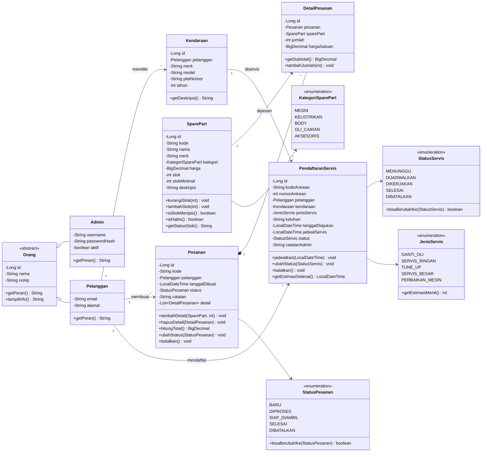

# Struktur OOP Kaboy Garage (Desktop Swing)

Dokumen ini menjelaskan rancangan object-oriented aplikasi **Kaboy Garage**
versi desktop untuk Laporan Akhir Praktikum Rekayasa Perangkat Lunak 2,
materi **Desain Perangkat Lunak**.

Arsitektur yang dipakai adalah **3-tier** sederhana:

```text
GUI Swing  ->  Service  ->  DAO/JDBC  ->  MySQL/MariaDB
   ^             ^             ^
   |             |             |
 model/dto   aturan bisnis   SQL & mapping
```

---

## 1. Class Diagram



---

## 2. Penerapan Konsep OOP

| Konsep | Penerapan pada project |
|---|---|
| **Class & Object** | `Orang`, `Admin`, `Pelanggan`, `Kendaraan`, `SparePart`, `Pesanan`, `DetailPesanan`, `PendaftaranServis`, dan enum domain. |
| **Encapsulation** | Semua atribut `private`. Koleksi detail pesanan dikembalikan sebagai `Collections.unmodifiableList()`, sehingga hanya bisa diubah melalui `tambahDetail()` / `hapusDetail()`. Stok hanya berubah melalui `kurangiStok()` / `tambahStok()`. |
| **Inheritance** | `Admin` dan `Pelanggan` mewarisi abstract class `Orang` yang menyimpan `id`, `nama`, dan `noHp`. |
| **Polymorphism** | Method abstrak `Orang.getPeran()` diimplementasikan berbeda: `Admin` mengembalikan `"Admin"`, `Pelanggan` mengembalikan `"Pelanggan"`. |
| **Abstraction** | GUI hanya memanggil method service; service menyembunyikan detail SQL/DAO. `Database.TransactionWork<T>` menyembunyikan mekanisme commit/rollback. |
| **Association** | `Pelanggan` — `Kendaraan`, `Pelanggan` — `Pesanan`, `Kendaraan` — `PendaftaranServis`. |
| **Composition** | `Pesanan` terdiri dari banyak `DetailPesanan`; detail tidak punya arti tanpa pesanan. Di database dipakai `ON DELETE CASCADE`. |
| **Enumeration** | `KategoriSparePart`, `StatusPesanan`, `StatusServis`, `JenisServis` membatasi nilai yang valid. |
| **Exception handling** | `AplikasiException` untuk kesalahan aturan bisnis, `StokTidakCukupException` untuk stok kurang, `DataAccessException` untuk kesalahan database. |
| **Layered architecture** | `gui` -> `service` -> `dao` -> `db` -> MySQL. |
| **DTO** | `ItemPesanan` untuk keranjang sementara; `Statistik` untuk ringkasan dashboard. |

---

## 3. Tanggung Jawab Tiap Layer

### 3.1 Model

Model menyimpan data sekaligus **aturan domain** yang melekat pada data:

- `SparePart.kurangiStok()` menolak jumlah negatif dan stok yang tidak cukup.
- `SparePart.getStatusStok()` menentukan label `Tersedia`, `Menipis`, atau `Habis`.
- `Pesanan.hitungTotal()` menjumlahkan subtotal seluruh detail.
- `Pesanan.tambahDetail()` menggabungkan item dengan spare part yang sama.
- `Pesanan.ubahStatus()` memvalidasi transisi status pesanan.
- `PendaftaranServis.jadwalkan()` memvalidasi jadwal dan memindahkan status ke
  `DIJADWALKAN`.
- `PendaftaranServis.getEstimasiSelesai()` = jadwal + durasi `JenisServis`.

### 3.2 DAO

DAO hanya bertanggung jawab pada operasi database:

- `AdminDao` — login dan mapping admin.
- `PelangganDao` — CRUD pelanggan.
- `KendaraanDao` — CRUD kendaraan dan query berdasarkan pelanggan.
- `SparePartDao` — CRUD, pencarian, stok menipis, kode berikutnya, serta
  operasi stok atomik (`stok >= jumlah`).
- `PesananDao` — insert header + detail dalam satu koneksi transaksi, query
  join, dan update status.
- `PendaftaranServisDao` — insert, query join, jadwal, status, dan nomor
  antrean harian.

Semua query memakai `PreparedStatement` untuk menghindari SQL injection.

### 3.3 Service

Service mengatur aturan lintas entity dan transaksi:

- `AuthService.login()` memvalidasi input dan memeriksa hash password.
- `SparePartService` menangani CRUD dan pesan error kode duplikat.
- `PelangganService` menangani pelanggan + kendaraan.
- `PesananService.buatPesanan()` menjalankan satu transaksi:
  ambil spare part terbaru -> buat detail -> kurangi stok -> simpan pesanan.
  Jika stok kurang, seluruh transaksi di-rollback.
- `PesananService.ubahStatus()` mengembalikan stok jika status menjadi
  `DIBATALKAN`.
- `WaitingListService.daftar()` membuat nomor antrean harian dan memastikan
  kendaraan milik pelanggan.
- `WaitingListService.jadwalkan()` dan `ubahStatus()` memvalidasi transisi
  status servis.
- `DashboardService` menyiapkan `Statistik` dan daftar terbaru.

### 3.4 GUI

GUI hanya menangani presentasi dan interaksi:

- `LoginFrame` — form login dan pengecekan koneksi database.
- `MainFrame` — sidebar, header, `CardLayout`, dan refresh panel.
- `DashboardPanel` — kartu statistik + tabel stok menipis/pesanan/antrean.
- `SparePartPanel` — form + tabel + pencarian.
- `PelangganPanel` — split view pelanggan dan kendaraan.
- `PesananPanel` — form pesanan, keranjang, tabel pesanan, dialog detail.
- `WaitingListPanel` — form pendaftaran, jadwal, status, dan tabel antrean.
- `Theme`, `FormatUtil`, `Refreshable` — utilitas tampilan dan kontrak refresh.

GUI tidak menulis SQL dan tidak menghitung stok sendiri; semua lewat service.

---

## 4. Alur Status

### 4.1 Pesanan

```text
BARU ──> DIPROSES ──> SIAP_DIAMBIL ──> SELESAI
  │          │
  └──────────┴──────> DIBATALKAN
```

Aturan:

- `BARU` boleh ke `DIPROSES` atau `DIBATALKAN`.
- `DIPROSES` boleh ke `SIAP_DIAMBIL` atau `DIBATALKAN`.
- `SIAP_DIAMBIL` hanya boleh ke `SELESAI`.
- `SELESAI` dan `DIBATALKAN` adalah status akhir.
- Pembatalan mengembalikan stok seluruh detail.

### 4.2 Servis

```text
MENUNGGU ──> DIJADWALKAN ──> DIKERJAKAN ──> SELESAI
    │             │
    └─────────────┴────────> DIBATALKAN
```

Aturan:

- `MENUNGGU` boleh ke `DIJADWALKAN` atau `DIBATALKAN`.
- `DIJADWALKAN` boleh ke `DIKERJAKAN` atau `DIBATALKAN`.
- `DIKERJAKAN` hanya boleh ke `SELESAI`.
- `SELESAI` dan `DIBATALKAN` adalah status akhir.
- Jadwal servis tidak boleh sebelum tanggal pendaftaran.

---

## 5. Relasi Database

| Entity | Tabel | Relasi |
|---|---|---|
| Admin | `admin` | — |
| Pelanggan | `pelanggan` | 1—N `kendaraan`, 1—N `pesanan`, 1—N `pendaftaran_servis` |
| Kendaraan | `kendaraan` | N—1 `pelanggan`, 1—N `pendaftaran_servis` |
| SparePart | `spare_part` | 1—N `detail_pesanan` |
| Pesanan | `pesanan` | N—1 `pelanggan`, 1—N `detail_pesanan` |
| DetailPesanan | `detail_pesanan` | N—1 `pesanan`, N—1 `spare_part` |
| PendaftaranServis | `pendaftaran_servis` | N—1 `pelanggan`, N—1 `kendaraan` |

Foreign key utama:

- `kendaraan.pelanggan_id -> pelanggan.id`
- `pesanan.pelanggan_id -> pelanggan.id`
- `detail_pesanan.pesanan_id -> pesanan.id` (`ON DELETE CASCADE`)
- `detail_pesanan.spare_part_id -> spare_part.id`
- `pendaftaran_servis.pelanggan_id -> pelanggan.id`
- `pendaftaran_servis.kendaraan_id -> kendaraan.id`

---

## 6. Transaksi Pembuatan Pesanan

```text
PesananPanel
    │  buatPesanan(pelanggan, items, catatan)
    ▼
PesananService
    │  validasi item + ambil harga terbaru
    │  Database.inTransaction(...)
    ▼
    ┌─────────────────────────────────────────────┐
    │ 1. UPDATE spare_part SET stok = stok - ?    │
    │    WHERE id = ? AND stok >= ?               │
    │ 2. Jika stok kurang -> exception -> rollback│
    │ 3. INSERT pesanan                           │
    │ 4. INSERT detail_pesanan                    │
    │ 5. COMMIT                                   │
    └─────────────────────────────────────────────┘
```

Jika salah satu langkah gagal, `Database.inTransaction()` memanggil
`rollback()`. Dengan demikian tidak ada pesanan yang tersimpan tanpa
pengurangan stok yang sesuai.

---

## 7. Keputusan Desain

1. **JDBC langsung, bukan Hibernate** — agar project desktop ringan, cukup
   satu JAR driver, dan mudah dijalankan di NetBeans tanpa resolusi dependency
   online.
2. **Model kaya aturan domain** — validasi stok, total, dan transisi status
   ditempatkan di model, bukan hanya di GUI.
3. **Service sebagai batas transaksi** — GUI tidak perlu tahu commit/rollback.
4. **Harga snapshot pada detail pesanan** — total pesanan lama tidak berubah
   saat harga katalog diperbarui.
5. **Enum untuk status** — mencegah status liar dan menyimpan aturan transisi
   di satu tempat.
6. **Seed data** — aplikasi langsung bisa dicoba setelah import SQL.
7. **Pemisahan versi web dan desktop** — versi web tetap ada di folder
   terpisah; project desktop ini tidak menghapus atau menimpa versi tersebut.

---

## 8. Pemetaan File

| Kebutuhan | File utama |
|---|---|
| Login | `gui/LoginFrame.java`, `service/AuthService.java`, `dao/AdminDao.java` |
| Dashboard | `gui/DashboardPanel.java`, `service/DashboardService.java` |
| Spare part | `gui/SparePartPanel.java`, `service/SparePartService.java`, `dao/SparePartDao.java` |
| Pelanggan | `gui/PelangganPanel.java`, `service/PelangganService.java`, `dao/PelangganDao.java`, `dao/KendaraanDao.java` |
| Pesanan | `gui/PesananPanel.java`, `service/PesananService.java`, `dao/PesananDao.java` |
| Waiting list | `gui/WaitingListPanel.java`, `service/WaitingListService.java`, `dao/PendaftaranServisDao.java` |
| Transaksi | `db/Database.java` |
| Model/domain | `model/*.java` |
| Uji | `tools/SmokeTest.java`, `tools/GuiSmokeTest.java` |
